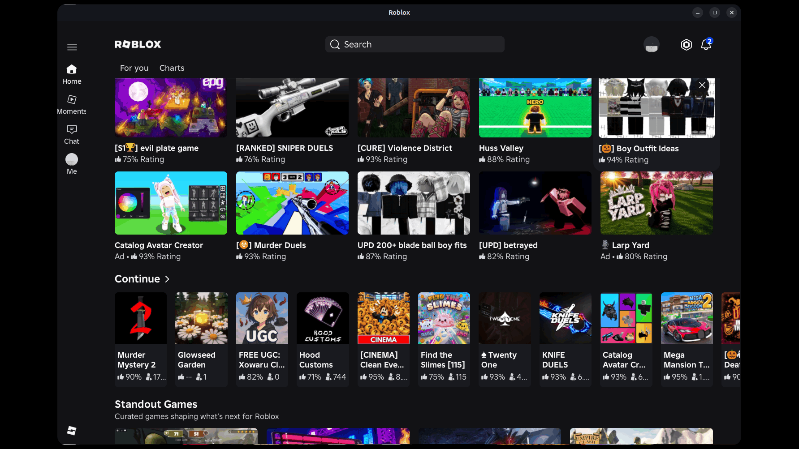
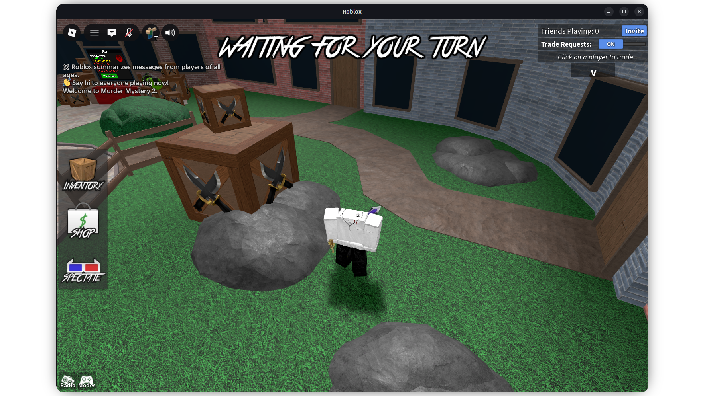

<!-- Modified by vii from komaruworld/mocktail. See "About this fork" below. -->
<div align="center">
  
  <h1 style="margin-top: 5px;">
    Nightcap
    <br>
    <a href="https://github.com/CoderDayton/nightcap/actions/workflows/ci.yml"></a>
    <a href="https://github.com/CoderDayton/nightcap/stargazers"></a>
    <a href="LICENSE"></a>
    <a href="https://discord.gg/DbAUG9hBFU"></a>
  </h1>
</div>

Nightcap is Roblox on Linux, tuned for desktop play. It is a Mocktail fork
that keeps up with Roblox updates, with extra bug fixes, custom assets and
more. It runs the Android `x86_64` Roblox client on Linux, including a Linux
userspace hosted by FreeBSD's Linuxulator. It provides the Android ABI and JNI
pieces the client expects, then connects them to SDL3 and Vulkan or OpenGL on
the Linux side.

Nightcap is an independent community project. It is not affiliated with Roblox
Corporation or VinegarHQ and does not distribute the Roblox client.

## About this fork

Nightcap is a fork of [komaruworld/mocktail](https://github.com/komaruworld/mocktail)
with extra fixes for playing on a PC. The program and config paths keep the
`mocktail` name so upstream fixes still apply cleanly. The app ID is
`io.github.CoderDayton.nightcap`, so Nightcap and upstream can be installed
side by side.

- **Roblox updates.** New versions work soon after release. The last working
  one is kept if an update fails.
- **More games.** Answers a server check some experiences use, so you can join
  and stay.
- **Login and voice chat.** Captchas finish, and your mic survives updates.
- **Mouse and keyboard.** The PC home screen and side menu, raw mouse input,
  and your own cursor theme.
- **Performance.** Less idle CPU use and faster texture loading.
- **Custom assets.** Cursors, fonts and skies go in
  `~/.local/share/mocktail/asset_overlay`, same layout as Sober's. Fleasion
  works too.
- **Overlays.** FPS, ping, and the server's location when you join.
- **Discord.** Shows the game you're playing.
- **Settings window.** Every option in one place.

More: [custom textures](textures/README.md) ·
[performance](docs/PERFORMANCE.md) · [FAQ](FAQ.md) ·
[changelog](CHANGELOG.md) · [roadmap](docs/ROADMAP.md)

## Install with AppImage

Grab the AppImage from the
[latest release](https://github.com/CoderDayton/nightcap/releases/latest),
make it executable, and run it:

```bash
chmod +x Nightcap-x86_64.AppImage
./Nightcap-x86_64.AppImage
```

## Install on Arch Linux from the AUR

[`nightcap-git`](https://aur.archlinux.org/packages/nightcap-git) builds the
current `main` branch. It is maintained by
[@dim-ghub](https://github.com/dim-ghub):

```bash
paru -S nightcap-git    # or: yay -S nightcap-git
```

## Install with Flatpak

```bash
flatpak install --user https://coderdayton.github.io/nightcap/nightcap.flatpakref
flatpak run io.github.CoderDayton.nightcap
```

Updates arrive through `flatpak update`. Nightcap is not on Flathub yet.

## Distribution packages

Each release also carries a DEB, an RPM, and a pacman package, with a
`.sha256` beside every file on the
[releases page](https://github.com/CoderDayton/nightcap/releases/latest):

```bash
sudo apt install ./nightcap_<version>_amd64.deb
sudo dnf install ./nightcap-<version>-1.x86_64.rpm
sudo pacman -U nightcap-<version>-1-x86_64.pkg.tar.zst
```

They install `/usr/bin/mocktail`, so they conflict with upstream's `mocktail`
package.

Nightcap is in no other distribution repository.

Or build and install from source using the steps under
[Building](#building).

## How it works

```
Roblox APK -> signature and ABI checks -> Bionic + JNI -> SDL3 + Vulkan/OpenGL
```

The APK is checked before any native code is loaded. It is downloaded on first
launch and is not bundled with Nightcap. The last working copy is kept in case
an update fails.

A leftover `.previous_good-recovery.json` in the payload store marks pending
recovery after a publication or restoration failure and blocks further payload
publication and garbage collection. Check `current.json` and `previous_good.json`
against the saved recovery state and fix the underlying problem before manually
removing the marker.

<details>
<summary>Screenshots</summary>





</details>

## FFlag overrides

Put a JSON object in `$XDG_CONFIG_HOME/mocktail/fflags.json` (usually
`~/.config/mocktail/fflags.json`). Nightcap applies it on the next launch.
The Advanced page of the [settings window](#settings) edits this file and
does not save text that Nightcap could not load.

PC profiles use the legacy Charts page by default to avoid the blank screen
caused by `Color3` errors in the newer SDUI page. An explicit
`FFlagLuaAppChartsAppPage` override takes precedence over this default.

PC profiles also set `FIntFlyoutTestVariantRollout12` to `2`, which shows the
desktop side panel menu. An explicit override takes precedence.

PC profiles compile the app's menus to native code with
`FFlagDebugLuauCodegenAll`, and turn it off while you are in a game. Setting
it yourself turns the switching off and your value applies everywhere. See
[docs/PERFORMANCE.md](docs/PERFORMANCE.md#native-code-in-the-menus).

```json
{
  "FFlagExample": "True",
  "DFIntExample": "120"
}
```
## Settings

Open the settings window from the app menu: right-click Nightcap and pick
Settings. Or run:

```sh
mocktail --settings
```

With the Flatpak, run
`flatpak run io.github.CoderDayton.nightcap --settings`. To open it with a
key, bind that command to a keyboard shortcut in your desktop's settings. If
Settings is missing from the menu right after you install, log out and back
in.

The window edits `~/.config/mocktail/config.yaml`. It keeps your comments
and layout, saves each change at once, and does not save a value Nightcap
could not start with. The overlay settings apply at once, even in game.
Other changes apply the next time Nightcap starts. If Nightcap is open, the
window offers to restart it, except in the Flatpak.

You can also edit the file by hand. Useful options:

- `graphics.frame_rate_limit: display` to unlock FPS to your monitor's rate.
- `graphics.vsync: off` for the lowest lag, at the cost of tearing.
- `graphics.backend: opengl` if Vulkan does not work on your GPU.

## Building

Linux `x86_64` is supported. Experimental FreeBSD 15.1 Linuxulator support has
been tested with an `x86_64` Fedora 44 userspace. On FreeBSD, Nightcap runs
inside Linuxulator; it is not a native FreeBSD binary. Building requires CMake
3.20+, Git, pkg-config, LLD, binutils, a C++17 compiler, SDL 3.4+, SDL3_ttf,
Vulkan, EGL, libplacebo, fontconfig, libcurl, OpenSSL, libelf, libyaml, libpng,
minizip, Capstone 5, utf8proc, nlohmann/json, GTK4, libadwaita 1.6+, and
WebKitGTK 6.0. FFmpeg's libavcodec is optional: without it, in-game video
stays black. libsecret is optional: without it, `auth.use_libsecret` has no
effect and the sign-in stays in a private file.

See the [FreeBSD Guide](packaging/freebsd/README.md) for setup and launch instructions.

<details>
<summary>Ubuntu 26.04+</summary>

```bash
sudo apt update
sudo apt install build-essential cmake git ninja-build pkg-config lld \
  libsdl3-dev libsdl3-ttf-dev libcurl4-openssl-dev libssl-dev \
  nlohmann-json3-dev libyaml-dev libpng-dev libelf-dev libminizip-dev \
  libcapstone-dev libgtk-4-dev libadwaita-1-dev libwebkitgtk-6.0-dev \
  libsecret-1-dev \
  libutf8proc-dev libfontconfig1-dev libegl-dev libvulkan-dev \
  libplacebo-dev libavcodec-dev zlib1g-dev
```
</details>

<details>
<summary>Arch Linux</summary>

```bash
sudo pacman -S --needed base-devel cmake git ninja pkgconf lld sdl3 sdl3_ttf \
  curl openssl nlohmann-json libyaml libpng libelf minizip capstone gtk4 \
  libadwaita libsecret webkitgtk-6.0 libutf8proc fontconfig libglvnd \
  libplacebo ffmpeg vulkan-headers vulkan-icd-loader zlib
```
</details>

<details>
<summary>Fedora 44+</summary>

```bash
sudo dnf install gcc-c++ cmake git ninja-build pkgconf-pkg-config lld \
  SDL3-devel SDL3_ttf-devel libcurl-devel openssl-devel \
  nlohmann-json-devel libyaml-devel libpng-devel elfutils-libelf-devel \
  minizip-ng-compat-devel \
  capstone-devel gtk4-devel libadwaita-devel webkitgtk6.0-devel libsecret-devel \
  utf8proc-devel fontconfig-devel libglvnd-devel vulkan-headers \
  vulkan-loader-devel libplacebo-devel ffmpeg-free-devel zlib-ng-compat-devel
```
</details>

```bash
git clone --recurse-submodules https://github.com/CoderDayton/nightcap.git
cd nightcap
make build
./build/mocktail
```

To install it for your user, with an app menu entry and Roblox link handling:

```bash
make install PREFIX=~/.local
```

Use `sudo make install` instead to install system-wide under `/usr`. To make
Roblox website links open the build tree copy without installing, run
`make register-url-handler`.

To build and install the Flatpak from source, install `flatpak-builder` and run
`make flatpak`. It builds with 2 parallel jobs to keep memory use low. Pass
`FLATPAK_JOBS=N` to `make flatpak`, or set `MOCKTAIL_FLATPAK_JOBS=N` for
`scripts/build_flatpak.sh`, to change that. To build without installing, run
`make flatpak-build`; the result stays in `build-flatpak/`.

To run the same checks as CI before each commit and push, install
[lefthook](https://github.com/evilmartians/lefthook) and run once:

```bash
lefthook install
```

## Known limitations

Nightcap does not currently work with `hardened_malloc`. Using
`hardened_malloc` may cause Nightcap to fail to start or crash during runtime.
Run Nightcap without `hardened_malloc` enabled.

## License

[Apache License 2.0](LICENSE). Third-party components keep their own licenses.

## Support

Support this fork by giving it a star or with:

<a href='https://ko-fi.com/U7U01WTJF9' target='_blank'></a>

LTC: `LdABR2ELRYrUESWZWrEk1uNx38gHHMuHUU`

Support the upstream project:

- USDT (TON): `UQCi6Yzcc9cOctoij6n_r1K90-OdVxAT0D_xo2UzGKkQaJDY`
- USDT (TRC20): `TNPMG9Vig2xiuo2r1QqnXRChPH7Vu28Jmx`
